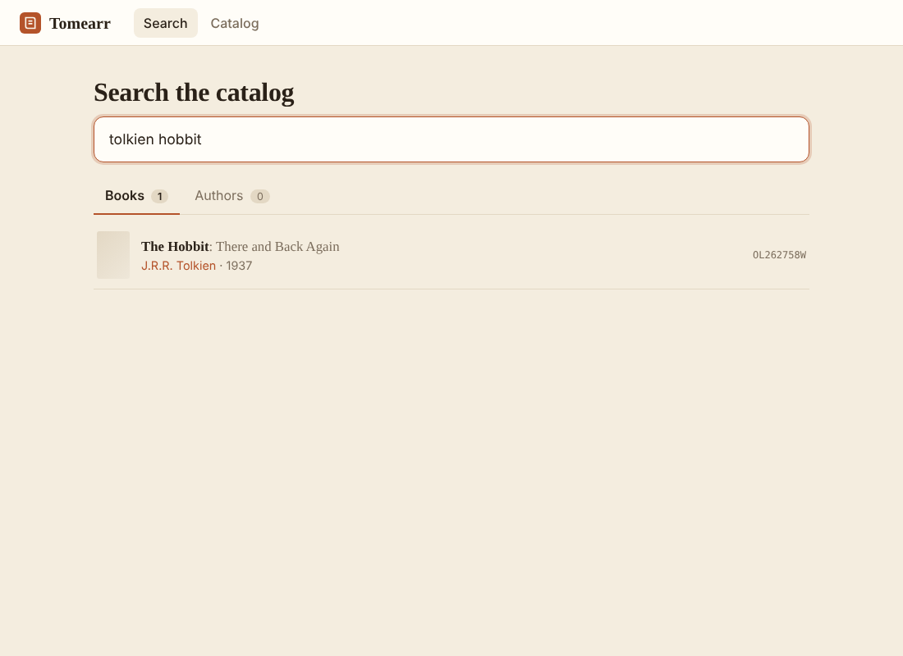

# Tomearr

A self-hosted ebook catalog and organizer in the style of the *arr apps. So far it is the catalog: it downloads
Open Library's bulk data dumps (authors, works, editions, ratings, reading log), loads them into a local SQLite
database, and gives you a fast search UI with ISBN lookup and popularity ranking, with no API, no rate limits and
no outside dependency once the data is in.



> **Status: early.** Phase 1 (authors and works) has been run on the real dumps. Phase 2 (editions, ISBNs,
> popularity) has been tested against synthetic dumps and a 1M-work / 3M-edition synthetic benchmark, not yet the
> real editions dump. Expect rough edges and please open issues.

## Roadmap

The full phased plan lives in the project notes; in short:

- [x] **Phase 1: catalog.** Dump downloader, streaming importer, FTS5 search, React UI.
- [x] **Phase 2: catalog quality.** Editions and ISBNs, edition counts, ratings and reading-log popularity,
      popularity-aware ranking, language filter, ISBN lookup, work detail page.
- [x] **Phase 3: library.** Read your Calibre library (read-only) and match it to catalog works.
- [x] **Phase 4: ingest scanner.** Identify and match every file in a drop folder, on an interval. Report only.
- [x] **Phase 5: review.** Keyboard-driven review of everything the matcher wasn't sure about.
- [x] **Phase 6: import.** Convert to EPUB and add to Calibre with Calibre's own tools; dry run, trash and undo.
- [x] **Phase 7: monitoring.** Monitored authors, a metadata profile, per-book want/ignore, the Wanted list.
- [x] **Phases 8–9: indexers and downloads.** Search Prowlarr, score releases, grab to Deluge / SABnzbd, follow them.
- [ ] **Phase 10: automation.** Search and grab wanted books on a schedule.

## Run on Unraid (or any Docker host)

```
docker compose up -d --build
```

Then open `http://<tower-ip>:8222`. Port 8222 taken? Create a `.env` file next to `docker-compose.yml` containing
`TOMEARR_PORT=<free port>` instead of editing the compose file; `.env` is git-ignored, so `git pull`
stays clean. Then, go to **Catalog**, and click **Download & build catalog**.

| Container path | Purpose |
|---|---|
| `/config` | SQLite database (`tomearr.db`). Put this on cache/SSD. |
| `/data` | Downloaded dump files in `/data/dumps`. |
| `/calibre` | Your Calibre library (the folder containing `metadata.db`), read-write so imports can add books. Set `CALIBRE_LIBRARY` in `.env` to change it. |
| `/ingest` | Drop folder for new and unsorted ebooks, read-write so imported originals can be moved to the trash. Set `INGEST_FOLDER` in `.env` to change it. |

Already have the dumps (the Open Library site offers torrents)? Put them in `/data/dumps` named
`ol_dump_<kind>.txt.gz` (no date, e.g. `ol_dump_editions.txt.gz`), then click **Import only**.

**Upgrading from Phase 1:** the database migrates itself on start. On the Catalog page only the missing dumps
(editions, ratings, reading log) are ticked; click **Download & build catalog** to fetch and import just those.
Search keeps working on the old index until the rebuild finishes.

### What gets downloaded

| File | Compressed size (per Open Library) | Used for |
|---|---|---|
| authors | about 0.5 GB | required |
| works | about 2.9 GB | required |
| editions | about 9 GB | ISBNs, languages, edition counts |
| ratings | a few MB | popularity |
| reading-log | about 65 MB | popularity |

The editions dump is the big one, and its table will be the largest part of `tomearr.db`. **Lite mode** (on the
Catalog page) keeps only editions with an ISBN and/or in chosen languages. Editions with no language listed are
always kept, since many ebooks leave it blank.

Imports show live progress as a percentage of the compressed file read; downloads resume if interrupted.

## Your library (Calibre)

Mount your Calibre library at `/calibre`. The compose file mounts `/mnt/user/appdata/calibre/Calibre Library`
read-only; for a different folder, put `CALIBRE_LIBRARY=/path/to/library` in `.env` rather than editing the
compose file. Then check it under **Settings → Test connection**, then **Library → Sync now**.

- Tomearr never opens Calibre's `metadata.db` directly. It copies it (and any `-wal` file) into
  `/config/cache`, checks the copy is consistent, and reads only the copy. It takes no lock on your library and
  is safe while Calibre, the content server or Calibre-Web is running. If Calibre writes during the copy it
  retries.
- Each book is matched to a catalog work: Calibre's `openlibrary` identifier first, then ISBN, then title plus
  author (fuzzy), then the titles of that author's editions (catches translations, e.g. a Swedish "Lida" is
  King's "Misery"). Matches show their method and a confidence; **Check match** lists anything under 90%.
- Tomearr expects messy records and works around them rather than asking you to clean Calibre first: author
  strings are cleaned (Calibre's `Tolkien| J.R.R.`, roles like "(Editor)", stray quotes, "Unknown"), titles are
  read with and without volume numbers, series notes and an author name tacked on, and a title match with a
  clearly different author is never accepted.
- Problems in a Calibre record itself are flagged under **Calibre problems**, for example an ISBN that belongs to a
  different book (the title and author win, and the ISBN is reported). Tomearr doesn't rewrite your existing
  Calibre records; fix those in Calibre.
- Use **fix** on a book to pick the right work or mark it "not in the catalog". Manual matches are never
  changed by a sync; "Back to automatic" undoes one.
- Re-syncing only re-matches books that changed in Calibre or are still unmatched (or everything, with
  **Sync and rematch all**). Books deleted from Calibre disappear from Tomearr's list.
- Search results, author pages and work pages show an **Owned** badge with the formats you have.

## Ingest folder

Tomearr scans the ingest folder on an interval (default every 5 minutes; **Settings**) and identifies every file.
Nothing is moved or changed yet; that's the import step.

- **Every format.** Files are identified by their contents, not just the extension. Embedded metadata is read from
  EPUB/KEPUB, MOBI/AZW/AZW3/PRC, PDF (document info, XMP, and an ISBN found on the first pages), FB2 (also
  zipped), DOCX/ODT, HTMLZ/TXTZ and Gutenberg-style TXT. Other formats (LIT, LRF, DJVU, CHM, RTF, DOC, KFX, ...)
  are matched from the file name, and from Calibre's `ebook-meta` once that is in the image. A `metadata.opf`
  next to a book is used too.
- **File names.** Several readings are tried ("Author - Title", "Title - Author", "Title (Author)",
  "Author/Title/" folders, release tags and site names stripped) and the one that matches the catalog best wins.
- **Buckets:** Matched (90%+), Review (60–89%), Unmatched, Duplicates, DRM, Archives, Comics, Errors.
- **Duplicates** are found by SHA-256, within the folder and against your Calibre library (only Calibre files of
  the same size are hashed). Matched books you already own show which formats Calibre has.
- **DRM** (Adobe ADEPT, Apple FairPlay, Kindle/Mobipocket, KFX, password-protected PDFs) is detected and flagged.
  Tomearr never removes DRM. Font obfuscation in EPUBs is not DRM and isn't flagged.
- **Interval scans are cheap:** only new or changed files (size or modified time) are read. Files modified in the
  last 2 minutes are skipped until the next scan, since they're probably still downloading or copying, and so are
  partial downloads (`.part`, `.!qB`, ...). Each file is read in a worker process with a time limit, so one broken
  file can't stall a scan. Polling is used rather than file-change notifications, which don't reliably reach a
  container from Unraid user shares.
- **Re-match all** re-runs matching without re-reading files (after a catalog update, say); **Full rescan** re-reads
  everything.

## Review

**Review** walks through the files the matcher wasn't sure about (the Review and Unmatched buckets), one at a
time, most promising first. For each file it shows what's known about it (and where that came from: the file,
a metadata.opf, the file name, or your edits) next to the candidate works, with covers, authors, year, editions,
whether you already own it, a score, and why: "ISBN … is an edition of this book", "title 100% similar", "same
author".

| Key | |
|---|---|
| Enter / A | accept the highlighted match |
| ↑ ↓ / J K | move between matches |
| 1 – 9 | accept that match |
| N | not a book |
| S | skip for now (it moves to Skipped) |
| E | edit the details (title, authors, series, ISBN, language); Enter finds matches for them |
| / | search the catalog; Enter searches, Enter again accepts |
| U | undo (a bulk action undoes as one) |
| ← → | previous / next file |
| ? | show the keys |

- **Bulk:** accept every match at N% or better, or every match to the current candidate's author. Both show how
  many files they'll touch first, and one **U** undoes them.
- Decisions are stored apart from the automatic match, so rescans and re-matching never overwrite them. If a
  file's contents change, its decision is cleared.
- Your edits are saved with the decision; the import step will write them into Calibre.
- **Ready to import** = files you accepted plus confident automatic matches you didn't overrule.

## Import into Calibre

**Import** shows a plan first (a dry run) and does nothing until you press Import. For each file:

1. it's copied to `/config/staging`; the original is never edited,
2. converted to EPUB if it isn't one (MOBI, AZW3, FB2, DOCX, ... via Calibre's `ebook-convert`),
3. the metadata is written into the EPUB: your edits, else the catalog's title and authors, plus ISBN, series,
   language and the Open Library id,
4. added to Calibre with Calibre's own `calibredb`, so Calibre names the `Author/Title (id)/` folders and files and
   updates `metadata.db`; if you already own the book, the EPUB is added to that book instead,
5. Calibre is asked to confirm the EPUB is there; only then are MOBI/AZW3/AZW/PRC removed from that book (each
   copied to the trash first; the list is in Settings),
6. the original leaves the ingest folder for `/config/trash`, kept 14 days by default, then deleted. With the
   trash set to 0 days it is deleted as soon as Calibre confirms (and that import can no longer be undone).

A failure part-way rolls back what reached Calibre. Every import can be undone (one book, or a whole run): the
book or EPUB comes out of Calibre, replaced formats go back in, and the original returns to the ingest folder.

- **PDFs** need your OK each time: convert, look at the result (text sample and a download link), then approve.
- **Archives** (zip, rar, 7z) are unpacked into a folder next to them; the next scan picks up what was inside.
- **Duplicates** of a file already in Calibre go to the trash (a setting).
- **Leftovers:** once a book leaves its folder, everything else there goes too if it's only leftovers (OPF,
  images, `.nfo`/`.sfv`, short `.txt`, OS clutter, empty subfolders), and so do parent folders that end up empty.
  A folder that still has a book, an archive, a partial download or any file type Tomearr doesn't recognise
  (an audiobook's `.mp3`s, say) is left alone. The plan also lists older leftover-only folders to clear out.
  Leftovers follow the trash setting and come back if you undo.
- **Already have it** (a different file of a book Calibre has as EPUB): **compare** shows both side by side
  (cover, words, chapters, table of contents, images, fonts, EPUB version, whether each looks publisher-made or
  converted/OCR'd, metadata, and the same passage from both) with a suggestion. **Keep Calibre's** trashes the
  file; **Use this one** replaces the EPUB in Calibre on the next import (old EPUB to the trash, undoable; a
  coverless Calibre record also takes the new cover); **Decide later** leaves it.
- **Books already in Calibre** that only have MOBI/AZW3/...: the second tab converts them to EPUB the same way.
- **Import automatically** after each scan is a setting (off by default).
- **Covers:** when an imported EPUB has no cover, the Open Library cover for its work (or its ISBN) is embedded
  before it goes into Calibre. **Library → Covers** does the same for books already in Calibre that have none.
  Only coverless books are touched. Covers by id come from the catalog; ISBN lookups are spaced ~3 s apart for
  Open Library's rate limit, and results (including misses) are cached in `/config/cache/covers`. Calibre has no
  command to remove a cover, so cover fixes can't be undone from Tomearr; change one in Calibre or Calibre-Web.

**How Tomearr writes to Calibre.** By default it runs `calibredb --library-path /calibre` directly: no login, the
same way Calibre-Web writes to the library. The Calibre desktop app keeps its own view in memory and shows books
added by other programs after a restart (or Library → Check library); Calibre-Web sees them straight away. A
*content server* mode is also there, but Calibre only accepts changes over the network from a logged-in Calibre
user, so it needs one.

The Docker image includes Calibre's official command-line build (`--build-arg CALIBRE_VERSION=x.y.z` pins one) and
`bsdtar` for archives.

## Wanted

Open an author and press **Monitor this author**. Every book of theirs that you don't have in Calibre and that
passes your profile goes on the **Wanted** list. The monitor setting can be changed later:

| Monitor | Wanted |
|---|---|
| All books | every book that passes the profile and isn't in Calibre |
| Future books only | only books that show up in the catalog after you chose this (after a catalog rebuild) |
| Selected books only | only books you mark **Want** |
| Not monitored | nothing (single books you marked Want stay wanted) |

**The profile** (Settings → Which books count as wanted) decides which of an author's Open Library works count:
English by default, at least 2 editions (books from the last two years need only one), and no collections, box
sets, omnibuses or study guides. Filtered books show the reason on the author page.

Every book has one status: **owned** (in Calibre), **in ingest** (wanted, and a file for it is in the ingest
folder), **wanted**, **ignored**, **filtered** or not monitored. **Want** and **Ignore** on a single book always
beat the author's setting. **New releases** lists recent books by monitored authors; Open Library only knows about
a book once it's in a monthly dump, so rebuild the catalog now and then.

## Indexers and downloads

Tomearr doesn't talk to indexers itself: **Prowlarr** already knows all of them, torrent and usenet. In Settings →
Indexers and download clients, give it Prowlarr's address and API key, Deluge's web UI address and password, and
SABnzbd's address and API key. Each has a Test button.

Press **Search** next to a wanted book (on the Wanted page, an author page, or a book's page). Tomearr asks Prowlarr
for book releases and checks each one against the book:

- passed over: audiobooks, comics, magazines, another language than your profile's, a name that doesn't contain the
  title, too big, no seeders, DJVU;
- ranked by format (EPUB, then AZW3/MOBI, which get converted, then PDF), how well the name matches the title and
  author, extra words (a different book in the series, a companion), seeders, and retail tags.

**Grab** sends a torrent to Deluge (with your label) or an NZB to SABnzbd (with your category). Tomearr fetches the
.torrent/.nzb through Prowlarr and uploads it, so the client doesn't need to reach your indexers. It then checks the
clients every minute: the **Downloads** tab shows progress. When a download finishes, the ingest folder is scanned
once the files have settled, and from there it's the normal flow: matched (a file named like the release you grabbed
is matched to that book), then imported. The book shows as *Downloading*, then *In ingest*, then *Owned*.

**Point the downloads at the ingest folder.** Set the Deluge label's "move completed to" folder, or the SABnzbd
category's folder, to the folder you mount as `/ingest` (on Tower, `/mnt/user/data/download/completed/ebooks`).

**Seeding.** When the ingest folder is also Deluge's download folder, moving an imported file away would break the
torrent. So a file that belongs to a torrent still in Deluge (any torrent, not only Tomearr's) is imported but left
where it is, shown on the Import page as *Still seeding*. Once you remove the torrent from Deluge, it shows up as
*Done seeding* and goes to the trash with the next import. If Deluge can't be reached, Tomearr assumes its own
torrents are still seeding. Turn this off in Settings if your torrents download somewhere else.

## How search works

- Authors and works are loaded from the dumps. Works with no author are skipped by default (toggle on the Catalog page).
- SQLite FTS5 indexes author names (including alternate names) and work titles plus author names.
- Every word you type is a prefix match and all words must match, so `tolkien hobbit` finds The Hobbit.
- **Popularity** per work = editions + 3 × ratings + 2 × "already read" + "currently reading" + "want to read".
  The works index is stored in popularity order, so a query pulls its most popular matches first, then they are
  reranked by how much of the title the query covers plus a log-scaled popularity term. An exact title match still
  beats a famous book with a partial match, but among equal matches the famous one wins.
- **Language filter** (next to the search box, default English) hides works with no edition in that language.
  Works whose editions list no language at all are always shown.
- **ISBN lookup:** type or paste an ISBN-10 or ISBN-13 (dashes and an `ISBN` prefix are fine). ISBN-10s are stored
  as ISBN-13; values with a bad checksum are dropped at import.
- Author results are ranked by how many works they have.

### API

| Route | |
|---|---|
| `GET /api/search/works?q=&lang=` | ranked works (`lang`: MARC code like `eng`, or `all`; defaults to the saved setting) |
| `GET /api/search/authors?q=` | authors |
| `GET /api/isbn/{isbn}` | editions and works for an ISBN |
| `GET /api/works/{key}` | work detail with editions, ISBNs, ratings, reader counts |
| `GET /api/authors/{key}` | author with works, each with `status`; plus `monitor` and `counts` |
| `GET /api/monitor/authors` | monitored authors with counts |
| `PUT/DELETE /api/monitor/authors/{key}` | `{"monitor": "all"\|"future"\|"selected"\|"none"}` / stop monitoring |
| `PUT /api/monitor/works/{key}` | `{"state": "wanted"\|"ignored"\|null}` |
| `GET /api/wanted?q=&waiting=` | wanted books (`waiting=false` hides ones with a file in ingest) |
| `GET /api/wanted/new?years=` | recent books by monitored authors |
| `GET /api/releases/{work_key}` | search Prowlarr for a book; ranked releases with reasons and rejections |
| `POST /api/grabs` | `{"work_key": ..., "release_id": ...}` sends a release to Deluge or SABnzbd |
| `GET /api/grabs`, `POST /api/grabs/refresh`, `DELETE /api/grabs/{id}` | downloads / check the clients now / forget one |
| `POST /api/downloads/test` | `{"client": "prowlarr"\|"deluge"\|"sabnzbd"}` |
| `GET/PUT /api/settings` | `language`, `calibre_path`, `ingest_path`, `ingest_interval_min`, `ingest_settle_sec`, `library_sync_interval_min`, import options, `profile_languages`, `profile_min_editions`, `profile_exclude_collections` |
| `POST /api/library/test` | check a Calibre folder (`{"path": ...}`, defaults to the setting) |
| `POST /api/library/sync` | sync job (`{"rematch": true}` re-matches everything except manual matches) |
| `GET /api/library?q=&filter=&offset=&limit=` | owned books; `filter`: all, matched, unmatched, low, not_epub, issues, manual |
| `GET /api/library/stats` | counts by match method and format |
| `PUT/DELETE /api/library/{calibre_id}/match` | set a manual match (`{"work_key": "OL…W"}` or `null`) / clear it |
| `POST /api/ingest/test` | check the ingest folder (`{"path": ...}`) |
| `POST /api/ingest/scan` | scan job (`{"full": true}` re-reads every file, `{"rematch": true}` re-matches) |
| `GET /api/ingest?bucket=&q=&offset=&limit=` | scanned files with metadata, match, candidates |
| `GET /api/ingest/stats` | bucket and format counts, review queue, ready to import, last scan summary |
| `GET /api/review/queue?which=` | file ids: `queue` (default), `skipped`, `accepted`, `not_book`, `matched` |
| `GET /api/review/{id}` | a file with its best reading and candidates (with reasons) |
| `POST /api/review/{id}/decide` | `{"action": "accept"\|"not_book"\|"skip"\|"reset", "work_key": ..., "overrides": {...}}` |
| `POST /api/review/{id}/rematch` | candidates for edited details (`title`, `authors`, `isbn`) |
| `GET /api/review/{id}/search?q=` | catalog search, as candidates for this file |
| `POST /api/review/bulk` | `{"min_confidence": 80}` or `{"author_key": "OL…A"}`, `dry_run` (default true) |
| `POST /api/review/undo` | undo the last decision or bulk action |
| `POST /api/calibre/test` | check Tomearr can write to Calibre |
| `GET /api/import/plan?library=` | dry run: what an import would do (`library=true`: convert books already in Calibre) |
| `POST /api/import/run` | `{"keys": [...] or null, "library": false}` starts an import job |
| `GET /api/import/history` | every import, with what was added, removed and trashed |
| `POST /api/import/{id}/undo`, `POST /api/import/batch/{job}/undo` | undo one import or a whole run |
| `POST /api/import/pdf/{file_id}` | `{"action": "convert"\|"approve"\|"reject"}`; preview at `/preview`, file at `/epub` |
| `GET /api/covers/missing`, `POST /api/covers/fix` | coverless Calibre books / fetch their covers (job) |
| `POST /api/catalog/{download,import,build,reindex}` | catalog jobs; import/build take `kinds`, `require_author`, `edition_languages`, `isbn_only` |

## Develop

```
# backend
cd backend && pip install -r requirements.txt pytest
python -m pytest
TOMEARR_CONFIG=./config TOMEARR_DATA=./data uvicorn app.main:create_app --factory --port 8222

# frontend (proxies /api to :8222)
cd frontend && npm install && npm run dev
```

## Layout

```
backend/app/    FastAPI app, job runner, scheduler, dump importer, search, Calibre reader, matcher, ingest scanner
backend/tests/  pytest suite using small synthetic dumps
frontend/src/   React UI (Search, Author, Work, Library, Ingest, Review, Catalog, Settings pages)
Dockerfile      builds the UI, then a slim Python runtime
```

## License

MIT. See [LICENSE](LICENSE). Open Library data is downloaded at runtime and is not part of this repository.
